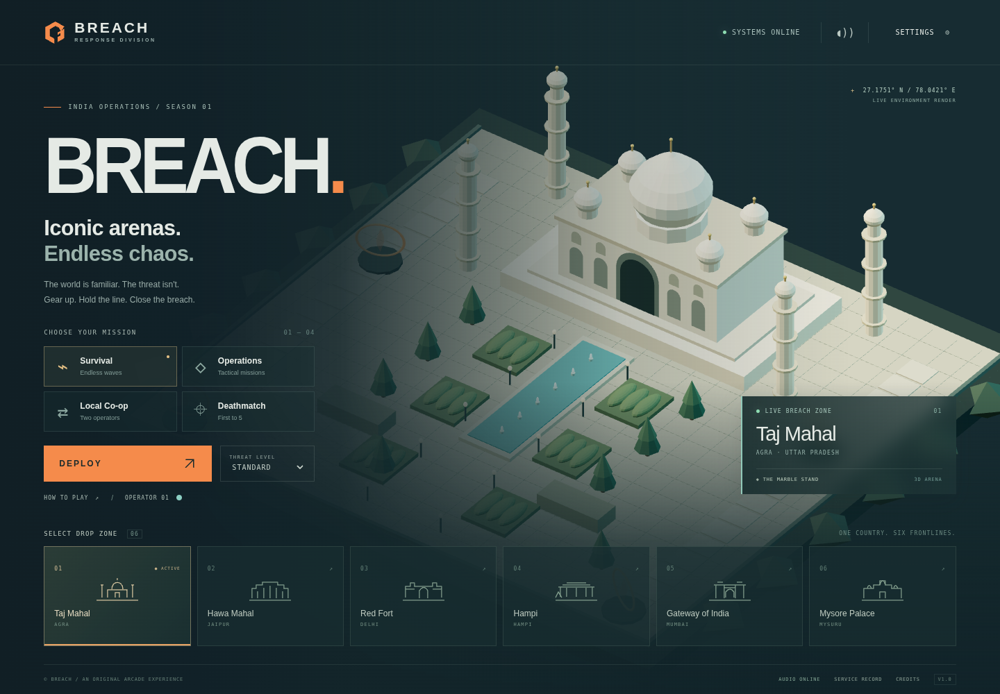

# BREACH

**Iconic Arenas. Endless Chaos.**

An original, free 3D browser arena shooter built with Three.js, TypeScript and Web Audio. Defend landmark-inspired arenas against creatures and machines that have their own missions. Saboteurs attack relays; scavengers steal physical energy cells and escape through portals. Staying alive alone is not enough.

Play at **https://lakshminarayanan2003.github.io/breach/**.



## Play and develop

Use **Node.js 24** and npm. No accounts, keys, environment variables, game servers, or streamed assets are needed.

```sh
npm install
npm run dev
```

Vite serves the game under `/breach/`. Audio unlocks on the first click or key press. For a production build:

```sh
npm run typecheck
npm run lint
npm run test
npm run build
npm run test:e2e
npm run preview
```

The browser suite uses `/usr/bin/chromium` when available. Otherwise install its browser once with `npx playwright install chromium`; Linux CI uses `npx playwright install --with-deps chromium`. Screenshots are written to `artifacts/`. The tests exercise the **production build**, so build before running browser tests.

## What is implemented

- Six original procedural 3D arenas: Taj Mahal, Hawa Mahal, Red Fort, Hampi, Gateway of India, and Mysore Palace. Each has its own architecture, collision map, objectives, lighting palette and synthesized ambience.
- Survival, four-wave Operations, shared-camera local co-op, and first-to-five local Deathmatch.
- Ten weapons/equipment: pistol, SMG, shotgun, explosive barrels, grenades, barricades, proximity mines, rockets, remote charges and penetrating railgun.
- Nine enemy classes with grid navigation, ranged attacks, protection, sabotage, resource extraction, bomber telegraphs and a three-phase boss.
- Ten pickups, nine upgrade tracks, camera shake, animated characters, projectiles, particle effects and tactical HUD.
- Campaign arena progression, weapon requisitions, high scores, best waves and an unlockable veteran suit. Survival and Deathmatch give immediate access to every arena and weapon; Operations/Co-op unlock arenas by completing the preceding mission and requisition equipment each wave.
- **124 original bundled PCM audio assets**, including ten musical compositions and six ambient beds. A shared audio engine provides spatial panning, distance attenuation, priority, voice limits, ducking, crossfades, live bus volumes and mute.
- Persistent remappable keyboard controls, gamepad input, three graphics presets, reduced camera motion and local versioned saves.

## Controls

**Phone and tablet:** drag the left thumb stick to move and the right stick to aim/fire. Release the right stick to stop firing. Tap a weapon in the horizontally scrolling strip, then aim/fire to shoot or place equipment. DASH works while moving; hold INTERACT to repair, collect, activate, or revive; DETONATE triggers remote charges. Pause and upgrades have touch buttons. Portrait and landscape are supported; landscape gives a wider view.

Touch controls Player 1. Local co-op and deathmatch need an additional keyboard or gamepad for Player 2; there is no online multiplayer or second touch controller. The first connected gamepad controls Player 2 in local multiplayer.

Use a current browser with WebGL 2 and Web Audio, such as Chrome, Safari, Firefox, Edge, or Samsung Internet. Browser-engine tests are distinct from physical phone testing; see [testing coverage](docs/TESTING.md). New touch-device saves default to Low graphics to reduce GPU load, while existing quality preferences are preserved. Sound starts after a tap. Backgrounding the page pauses gameplay; tap Resume when you return.

| Action                     | Player 1            | Player 2                |
| -------------------------- | ------------------- | ----------------------- |
| Move                       | WASD                | Arrow keys              |
| Aim                        | Mouse               | Last movement direction |
| Fire / deploy              | Left click or Space | `/`                     |
| Switch weapon              | Q / E or 1–0        | `.`                     |
| Dash                       | Left Shift          | Right Shift             |
| Interact / repair / revive | F                   | Enter                   |
| Detonate charges           | R                   | `,`                     |
| Pause                      | Esc / P             | Esc / P                 |

All action keys can be remapped in Settings. Duplicate bindings and reserved pause/number keys are rejected. Gamepads use left/right sticks, RT/A fire, B dash, X interact, Y detonate, and LB/RB weapon switching. The first connected pad controls P2 in local multiplayer; in solo play it controls P1.

Hold Interact near a transmitter for two seconds to activate it, or near a downed co-op partner for two seconds to revive. Interact also secures nearby energy cells and repairs relays. Explosives can hurt their owner; friendly explosive damage is reduced outside Deathmatch. Each equipment type starts with a six-item placement limit per player, increased by upgrades.

## Operations

All operations require four cleared waves, including a boss, and fail if any relay is destroyed, four cells are extracted, or the response team falls.

| Arena            | Additional objective                                                                  |
| ---------------- | ------------------------------------------------------------------------------------- |
| Taj Mahal        | Keep three relays intact and intercept carriers                                       |
| Hawa Mahal       | Secure five cells with Interact                                                       |
| Red Fort         | Protect the central generator                                                         |
| Hampi            | Activate all three transmitters with Interact                                         |
| Gateway of India | Secure five cargo cells, then remain near the support drone as it moves to extraction |
| Mysore Palace    | Protect both relays and defeat the Sovereign                                          |

## Verification and limits

See [TESTING.md](docs/TESTING.md) for actual results and the distinction between simulation tests, browser input tests and audio signal tests. This is a playable implementation, but the full product brief also calls for subjective polish and broad hardware/browser validation that automated tests cannot establish. Current limits are recorded in [ROADMAP.md](docs/ROADMAP.md).

The project is configured for GitHub Pages at `/breach/`. The intended repository is `LakshmiNarayanan2003/breach`; the intended website is `https://lakshminarayanan2003.github.io/breach/`. These are deployment targets, not proof of a live release. See [DEPLOYMENT.md](docs/DEPLOYMENT.md) for the verified publication status.

## Data and licenses

Only settings, bindings and progression are stored in `localStorage` under `breach.save.v1`. No analytics, accounts or personal-data uploads. Private browsing or disabled storage may prevent persistence; gameplay still works. Clearing site data resets the campaign.

Original source and procedural visual assets: [MIT](LICENSE). Original generated audio: [CC0 1.0](public/audio/LICENSE.md), with provenance and composition details in [AUDIO_CREDITS.md](docs/AUDIO_CREDITS.md). Third-party libraries retain their own licenses; see [ASSET_CREDITS.md](docs/ASSET_CREDITS.md).

Useful references: [game design](docs/GAME_DESIGN.md), [architecture](docs/ARCHITECTURE.md), [audio system](docs/AUDIO_SYSTEM.md), [contributing](CONTRIBUTING.md).
